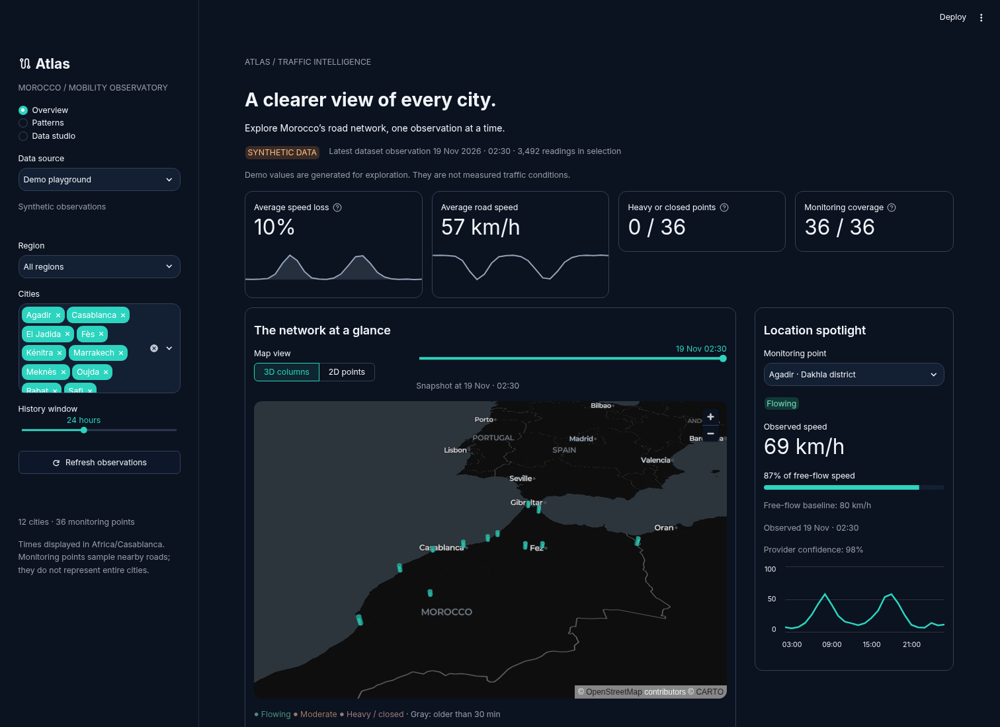

# Atlas · Morocco traffic observatory

A Streamlit dashboard for exploring traffic across **12 Moroccan cities and 36 monitoring points**. Built on the original Casablanca collector, with a dark teal theme, interactive 2D/3D maps, time replay, city comparisons, hourly heatmaps, and a searchable observation explorer.



## Open the dashboard

```bash
uv sync --locked
uv run streamlit run dashboard.py
```

The **Demo playground** opens immediately with seven days of clearly labeled synthetic readings. No database or API key is required. Map tiles and web fonts require internet access; the 3D map needs a WebGL-capable browser.

Use the sidebar to select regions, cities, and a 6-hour to 7-day history window. Switch between **Overview**, **Patterns**, and **Data studio**. Select a single city to see individual monitoring points; the national map aggregates points by city. Columns encode speed loss, not real buildings. Click a column to scope the location spotlight, or use the monitoring-point selector.

## Connect real observations

```bash
docker compose up -d db
cp .env.example .env
```

Set `TOMTOM_API_KEY` and `DATABASE_URL` in the local `.env` file, then run:

```bash
uv run --env-file .env python ingest.py --init-db
uv run --env-file .env python ingest.py
uv run --env-file .env streamlit run dashboard.py
```

Choose **Live database** in the dashboard. The refresh button rereads stored observations; it does not call the provider. The dashboard never substitutes synthetic readings for a failed live database connection. Environment variables take precedence over `DATABASE_URL` in `.streamlit/secrets.toml`. Local secrets, `.env`, databases, and SQL backups are ignored by Git.

For a smaller collection batch:

```bash
uv run --env-file .env python ingest.py --cities Casablanca Rabat
```

Schedule the collector every 5–15 minutes using your scheduler, within your API allowance. Each run makes one request per selected monitoring point, with up to three retries for transient failures. The API key is read only from the environment. The former ignored `Constants.py` file is no longer imported by the application.

## Cities

Casablanca, Rabat, Marrakech, Tangier, Fès, Agadir, Meknès, Oujda, Kénitra, Tétouan, El Jadida, and Safi. Each city has three district monitoring coordinates in `city_catalog.py`. These approximate sample points are sent to TomTom, which returns a nearby road segment. A city’s three samples are **not a citywide congestion estimate**; provider coverage varies by point.

## Database and pipeline

The normalized model is `cities → locations → traffic_readings`, with `ingestion_runs` providing collection lineage. PostgreSQL stores PostGIS points, raw JSON provider payloads, UTC observation times, speed, free-flow speed, confidence, and road-closure flags. Composite indexes support location/time and source/time queries; `city_hourly_traffic` provides hourly rollups.

The collector validates finite, nonnegative speeds, positive free-flow speeds, boolean closure flags, and confidence in [0, 1]. Writes are transactional. A unique `(location_id, recorded_at, source)` identity makes exact observation replays idempotent. Runs report accepted and failed measurements; a partially failed live run exits with status 1, while a missing API key exits with status 2. No exception URLs containing keys are logged.

`--init-db` creates the schema or migrates the original Casablanca tables in place, preserving existing observation IDs and values. Existing locations without a city are assigned to Casablanca. Catalog seeding is idempotent. Back up an existing database first:

```bash
docker compose exec -T db pg_dump -U traffic_user traffic_db > data/backup.sql
uv run --env-file .env python ingest.py --init-db
```

Existing duplicate point names within a city, duplicate observation identities, null/invalid speeds, or invalid coordinates cause the migration transaction to fail rather than silently discard data. Resolve such legacy issues before retrying. Docker initialization scripts only run on a new volume; use `--init-db` to upgrade an existing volume. Do not remove your volume to migrate.

SQLite is available for local exploration when `DATABASE_URL` is unset:

```bash
uv run python ingest.py --demo
uv run streamlit run dashboard.py
```

Choose **Stored demo** to read `data/traffic.db`. Synthetic rows have `source=demo`; live queries use `source=tomtom` exclusively. The in-memory playground never writes to a database. SQLite supports the normalized schema and constraints; PostGIS geometry and the hourly SQL view are PostgreSQL features.

## Metric definitions

- **Speed loss:** `100 × (1 − min(current_speed / free_flow_speed, 1))`; higher means slower traffic.
- **Flowing:** at least 70% of free-flow speed. **Moderate:** 40–70%. **Heavy:** below 40%. Provider road closures override these labels.
- **Coverage:** selected points with at least one observation in the chosen history window, not a live freshness guarantee.
- **Freshness:** live points older than 30 minutes trigger a warning. Map points are gray when their contributing observations are older than 30 minutes relative to the replay time. City aggregates conservatively use the oldest contributing point.
- KPI cards and city ranking use the latest available observation per point. Trend charts and heatmaps use means of recorded observations; gaps are not filled with zero. The history window ends at the latest dataset observation and is limited to the last seven days of stored data.
- CSV exports include all matching observations in the selected window, with UTC timestamps. The table shows the newest 1,000 matching rows; displayed times use `Africa/Casablanca`.

## Validation

```bash
uv run python -m unittest discover -s tests -v
```

Tests cover schema seeding, invalid provider responses, deterministic demo data, source isolation, duplicate inserts, transaction rollback, time replay, city filtering, empty states, map modes, patterns, and data exploration. Streamlit AppTest validates application behavior; it does not render WebGL tiles.

## References

[TomTom Flow Segment Data](https://docs.tomtom.com/traffic-api/documentation/tomtom-maps/v1/traffic-flow/flow-segment-data) · [PyDeck](https://deckgl.readthedocs.io/en/latest/deck.html)
